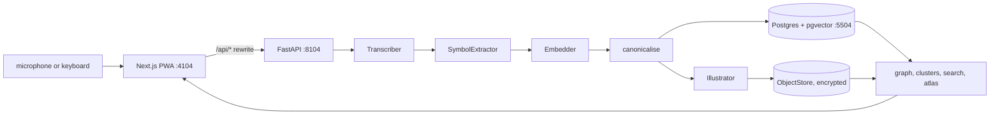

# Architecture

One page. The README has the stories; this is the map.

## One entry, start to finish

`Dreamlog.create_from_audio` in `api/dreamlog/service.py` is the whole pipeline: decode the upload with PyAV, transcribe, delete the audio, extract symbols and moods, embed the transcript and every symbol in one batch, fold the symbols into the canonical list, paint the picture, write the row. One HTTP request, so "stop to saved" is one number. Editing a transcript reruns everything after transcription.

## The swappable parts

Each is a `Protocol` with a real implementation and an offline one. `build_services` picks from settings.

| Interface | Default | Alternative | Test stand-in |
|---|---|---|---|
| `Transcriber` | faster-whisper `base.en`, local | other Whisper sizes by env | `FakeTranscriber` |
| `SymbolExtractor` | `LexiconExtractor`, deterministic | `AnthropicExtractor`, strict JSON schema | lexicon |
| `Embedder` | all-MiniLM-L6-v2 through ONNX Runtime | another fastembed model | `HashEmbedder` |
| `Illustrator` | `ProceduralIllustrator` | `ApiIllustrator`, falls back to the painter | painter |
| `ClusterNamer` | most central member | `AnthropicNamer` | central |
| `ObjectStore` | `LocalDirStore` in `EncryptedStore` | S3-compatible: implement the same five methods | local |

## Canonical symbols

A canonical symbol is a connected component of a graph over every surface form the journal has used, with an edge between two forms of the same kind whose embeddings ("a door", "an ocean") have cosine similarity of at least 0.60. `canonical.py` maintains this incrementally: a new form joins the component it touches, founds one, or bridges several and merges them. The result does not depend on the order entries arrive in. Deleting an entry prunes its words but never splits a component. The threshold comes from `scripts/calibrate_threshold.py`.

## Data

`entries(id, created_at, transcript bytea, mood[], embedding vector(384), image_key, ...)`, `symbols(id, canonical, kind, embedding, glyph)`, `symbol_aliases(alias, symbol_id, kind, embedding)`, `entry_symbols(entry_id, symbol_id, salience, surfaces[])`. Search is cosine distance on `entries.embedding` plus a symbol channel: a query that would canonicalise into an existing symbol returns every dream carrying it. The graph is a self-join on `entry_symbols`; clusters are HDBSCAN over `symbols.embedding`, computed on request.

## Pictures

`illustrate/procedural.py` lays out a scene from the entry's symbols and writes one SVG; `resvg` rasterises it; Pillow writes WebP. Glyphs are hand-written paths in a 100 by 100 box (`glyphs.py`), placed by transforming coordinates so filter noise keeps one scale. The seed is a hash of the entry id. The monthly atlas (`atlas.py`) reuses the same paint and is cached in the object store under a hash of its inputs.

## Privacy boundary

Encrypted with AES-256-GCM under one key: transcripts (bound to the entry id), and every object in the store (bound to its path). Not encrypted, because Postgres computes on them: embeddings, symbol names and aliases, moods, timestamps. Audio is written to a temp file, transcribed and unlinked inside one call unless `DREAMLOG_KEEP_AUDIO` is set. `delete_all` truncates every table, empties the store and replaces a generated key. The service worker never caches `/api`.

## Invariants

- Same entry id, symbols and mood give the same SVG, byte for byte.
- Only `Database.write` changes symbol tables, under one advisory lock.
- No hand-written mapping from one symbol to another exists anywhere. A test greps for it.
- The renderer depends on how the pinned `resvg_py` handles `feDisplacementMap`. A canary test measures it.

## Decisions I would revisit

- Components chain: house, home, room and hotel end up as one symbol. Complete linkage would be tighter but needs stable ids across re-clustering.
- Whole-transcript embeddings rank well but give no clean cut-off, so search returns a top ten.
- Clustering and the graph are recomputed per request. Fine for hundreds of entries; a materialised table after that.
- No accounts. The API binds to localhost and trusts whoever can reach it.
