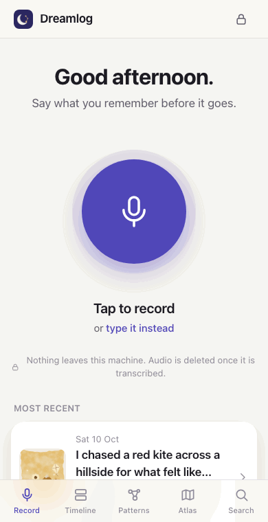
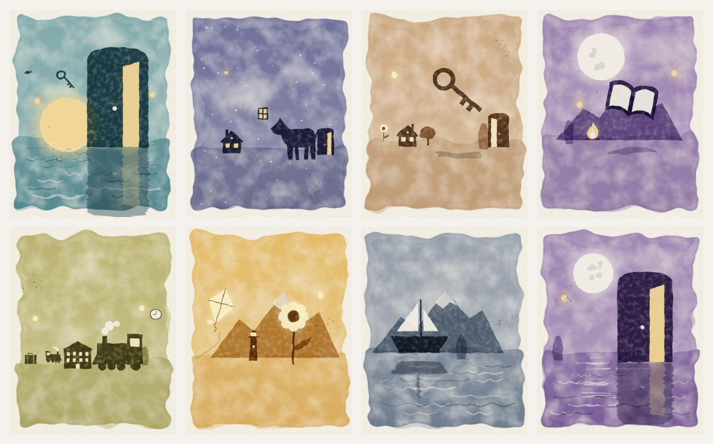
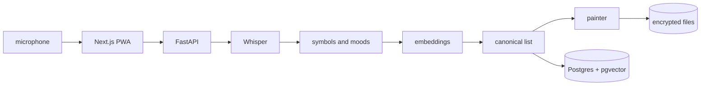
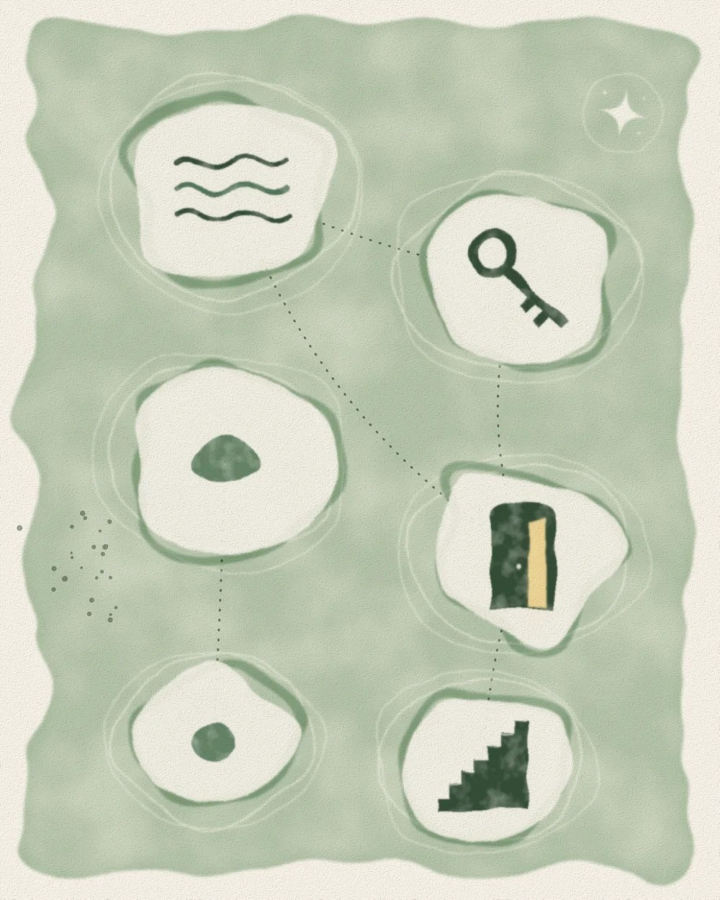
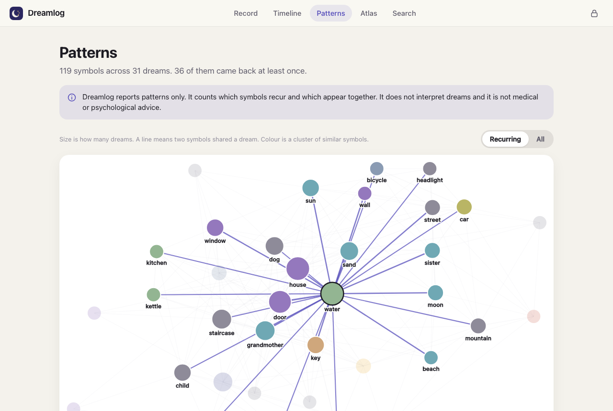

<div align="center">

# Dreamlog

### say the dream before it goes, and get a painting of it back

[](api)
[](web)
[](#what-stays-private-and-what-does-not)
[](api/tests)
[](LICENSE)

<br>



</div>

<br>

> **Dreamlog reports patterns and stops there.** It will tell you that water has turned up in eight of your dreams and that it tends to arrive with a door. It will never tell you what either of those means, and nothing in it is medical or psychological advice. The app says the same thing on its own screens.

On waking you tap one button and mumble what you remember. About five seconds after you stop talking there is an entry: your words transcribed, the things in the dream picked out, a mood or two, and a small watercolour made from all of it. Keep doing that for a few months and the patterns screen starts to show you which symbols keep coming back and which ones travel together.

Speech recognition, embeddings, the painting and the database all run on your own machine. A dream journal is about as private as text gets, so the default configuration sends nothing anywhere.

<p align="center"></p>
<p align="center"><sub>Eight entries, eight paintings. The colour is the mood. No image model was involved: these are SVG filters and 41 hand-written shapes.</sub></p>

<br>

## Table of contents

- [Run it](#run-it)
- [What happens to one dream](#what-happens-to-one-dream)
- [Teaching it that an ocean is water](#teaching-it-that-an-ocean-is-water)
- [The painter](#the-painter)
- [Patterns, search and the atlas](#patterns-search-and-the-atlas)
- [What stays private and what does not](#what-stays-private-and-what-does-not)
- [The parts that fought back](#the-parts-that-fought-back)
- [Acceptance tests](#acceptance-tests)
- [Limitations](#limitations)
- [Next](#next)
- [Layout](#layout)

<br>

## Run it

```bash
git clone https://github.com/ayaan-gupta/dreamlog && cd dreamlog && make dev
```

Then open http://localhost:4104. You need Docker, Python 3.12, Node 22 and `make`. No keys.

That one command builds a virtualenv, installs the web app, starts Postgres with pgvector in a container, and brings up the API beside the Next.js client. A first run took 70 seconds on my machine, most of it spent downloading 228 MB of speech and embedding models.

`make seed` loads 30 sample dreams so the patterns screen has something to show. `make test` runs all 97 tests, including the ones that load the real models. `make help` lists the rest.

Ports are 4104 for the web app, 8104 for the API and 5504 for Postgres, each bound to 127.0.0.1 and each overridable. [.env.example](.env.example) documents every setting.

<br>

## What happens to one dream



It is a single HTTP request, which makes "stop recording to saved entry" one honest number. Here is the breakdown for a 60.9 second clip on an M5 Pro, measured through the web proxy on a warm server:

| Stage | What runs | Time |
|---|---|---|
| Transcribe | faster-whisper `base.en` on CPU, then the audio is deleted | 2.63 s |
| Extract | symbols and moods from the transcript | under 1 ms |
| Embed | the transcript and every symbol, all-MiniLM-L6-v2 through ONNX Runtime | 0.07 s |
| Canonicalise | fold new words into the symbols you already have | 0.02 s |
| Paint | lay out a scene, rasterise it with resvg, write WebP | 1.81 s |
| **Total** | | **4.54 s** |

Every stage sits behind a small interface with a local implementation and a stand-in for tests. Two of those interfaces also have a Claude-backed version (symbol extraction and cluster naming), and the painter has an image API version. I had no keys on the build machine, so those three have only ever met stub clients. More on that under [Limitations](#limitations).

<br>

## Teaching it that an ocean is water

If "ocean" on Tuesday and "water" on Friday count as different symbols, the recurrence graph is useless. The PRD asks for an embedding match against a canonical list, and choosing the threshold for that match turned out to be most of the work.

I wrote 100 word pairs by hand, 40 that should merge and 60 that should stay apart, and deliberately left water and ocean out so they could serve as a held-out check. Five embedding models were tried with several phrasings each. The winner was all-MiniLM-L6-v2 with an article in front of the word ("a door" beats "door"), at an AUC of 0.978. F1 peaks at a cosine similarity of 0.60. Water and ocean, unseen until then, scored 0.653.

`scripts/calibrate_threshold.py` reprints the whole comparison.

Two rules sit on top of the similarity score, and both exist because the first version failed in public:

- **Only symbols of the same kind may merge.** The calibration set had synonyms in it but nothing that was merely associated. On the sample dreams the model happily merged dentist into tooth at 0.80 and teacher into school at 0.63. No threshold separates those from water and ocean, so a person is now never allowed to join an object.
- **A symbol is a connected component, built so that order cannot matter.** The story of how I found out that it did matter is [below](#the-parts-that-fought-back).

There is no synonym table anywhere in the code. A test greps for one.

<br>

## The painter

The PRD's style bible reads: soft watercolour, dreamlike scale distortions, one dominant colour per mood, no text, no recognisable people. It imagines an image model doing this at runtime. That adapter exists, but the default is a painter I wrote, because a private journal that ships your dreams to an image API by default would be an odd thing to build.

The painter lays out a scene from the entry's symbols as a single SVG, which resvg then rasterises. Washes are turbulence filters and edges wobble through a displacement map. The things in the dream come from 41 hand-written glyphs. Scale is deliberately wrong: doors stand taller than houses. People are never drawn. They appear as standing stones.

Its vocabulary is small, and anything it has no glyph for becomes a floating light. Each picture is seeded by the entry's id, so the same dream always paints the same way.

<p align="center"></p>
<p align="center"><sub>The atlas for one month: its six strongest symbols, joined where they shared a dream.</sub></p>

Design-time art is a separate matter. The brief forbids me from generating images, so the eleven I wanted (app mark, install icons, onboarding and empty-state pictures) are written up as requests in [assets/prompts.md](assets/prompts.md). Code-drawn versions in `assets/interim` hold their places until real ones land in `assets/generated`.

<br>

## Patterns, search and the atlas

<p align="center"></p>

**The graph.** Nodes are canonical symbols sized by how many dreams they appear in. A line means two symbols shared a dream. The layout is a small deterministic force simulation written for this, so the picture does not reshuffle on every visit.

**Clusters.** HDBSCAN over the symbol embeddings decides the colours. Each cluster is named after its most central member unless a Claude key is set.

**Search.** A query is embedded and compared with every transcript by cosine distance. A second channel checks whether the query would canonicalise into a symbol you already have, in which case every dream carrying that symbol comes back too. Searching "being chased" finds a dream about a black car *tailing* someone, which contains no form of the word.

**The atlas.** One poster a month, downloadable as a PNG.

<br>

## What stays private and what does not

| | |
|---|---|
| Speech recognition | local, faster-whisper |
| Embeddings | local, ONNX Runtime |
| Illustration | local, the built-in painter |
| Audio | written to a temp file, transcribed, then deleted in the same call. Retention is opt-in. |
| Transcripts | AES-256-GCM, bound to the entry id |
| Pictures and any kept audio | AES-256-GCM, bound to their storage path |
| Embeddings, symbol names, moods, dates | **stored in the clear**, because Postgres has to compute on them |
| Export | one click, a zip of everything |
| Delete-all | one click. A test checks that every table, vector column and file is empty afterwards |

That bold row matters. Someone with a copy of the database cannot read your transcripts, but they can see which symbols recur and get a fair idea of what each dream was about. The key, when you do not supply one, is generated and kept beside the data, which protects against a stolen backup of one and does nothing against a stolen laptop. There are no accounts either. Whoever can reach the port can read the journal, and that is the reason both servers bind to localhost.

<br>

## The parts that fought back

**resvg applies a displacement map's scale twice.** My first render had no sky. Every wash had vanished. I bisected the filter chain and found that `feDisplacementMap` on its own could erase a 160 pixel circle at scale 30. A flat map of one known colour settled it: scales of 2, 4, 8 and 16 moved a square by 2, 8, 32 and 128 pixels, where the SVG spec says 1, 2, 4 and 8. The shift is scale squared over two. The painter now asks for the square root of what it wants. `resvg_py` is pinned to 0.5.0, and a canary test fails the day an upgrade fixes the bug. The honest consequence is that these SVGs only look right in this renderer. A browser would show less wobble.

**Canonicalisation depended on the order of the dreams, and I found out by accident.** Version one compared a new word against each existing symbol's *name* and joined the nearest. The latency test happened to print its symbols, and there sat "ocean" and "water" as separate entries. A warm-up clip had mentioned a river. Water joined river at 0.68, and ocean, which scores just under 0.60 against river, was left standing alone. I rewrote it as connected components over a similarity graph of every word form the journal has used, maintained incrementally, with a merge whenever a new word bridges two symbols. A test now loads the 30 dreams in five different orders and demands the identical partition. The price is chaining: house, home, apartment, room, hall, hotel and attic all end up as one symbol, because each is close to the next.

**Sentence-level search was worse.** I assumed that scoring a dream by its best-matching sentence would beat one embedding for the whole transcript. For "being chased" it scored an average precision of 0.52 against 1.00 for whole transcripts. "She kept running ahead and coming back", which is about a dog, outranked real pursuit dreams. So did "I chased a red kite". Whole transcripts stayed.

**Two libraries that will not speak to each other.** The first transcription died inside faster-whisper with `open() got an unexpected keyword argument 'metadata_errors'`. PyAV 19 had dropped a keyword that faster-whisper 1.2.1 still passes. Audio is now decoded by my own code and handed to Whisper as an array of samples.

**The fixture that existed only on my disk.** `.gitignore` had a bare `data` line, meant for the local data folder. It also matched `api/dreamlog/data/`, where the sample dreams live. Every test passed locally for hours. The first fresh clone failed with `FileNotFoundError`, which is exactly what fresh clones are for.

Smaller surprises: resvg holds the GIL, so four threads painted eight pictures in the same 14 seconds as one. The macOS `say` command refuses to speak below a certain rate, and my 60 second test clip needed silent pauses inserted between sentences to reach its length. An entry about a grandfather was once labelled "grandmother" because I showed the canonical name where the spoken word belonged. And the October atlas came out an angry red when five moods tied at one dream each and the tie broke alphabetically.

<br>

## Acceptance tests

| PRD test | Result | Measured |
|---|---|---|
| "water" and "ocean" merge into one canonical symbol on the 30-dream fixture | Met | One symbol holding lake, ocean, river, sea and water, present on 8 of the 8 dreams labelled as water. Same partition in five orderings. |
| Search for "being chased" returns the dreams tagged with pursuit | Met | All 7 pursuit dreams in ranks 1 to 7 of a top ten. Only one of them contains the letters "chas". |
| Delete-all removes every row, file and embedding | Met | 32 entries, 119 symbols, 314 stored vectors and 7 files before. Zero of each after, with table files at 0 bytes. |
| Stop-recording to saved entry in under 20 s for a 60 s clip | Met | 4.5 to 4.7 s in my own check from a fresh clone. Medians between 4.35 and 7.80 s across sessions as machine load varied, slowest single run 9.68 s. |

Those results deserve their caveats. The 30 dreams and their labels are fiction that I wrote for this project. Nobody dreamed them, and a pipeline tuned by the same person who wrote its test data should be read with that in mind. The speech in the latency test is the macOS voice Samantha, which Whisper transcribed without a single wrong word. A real person at 6 a.m. will do worse on accuracy, though the timing should hold. The latency is also for a warm server, since the first request after startup has to load both models.

<br>

## Limitations

- **Nothing here has met a real dream or real morning speech.** English only.
- **The default extractor is a word list.** It has 581 entries and one grammar pattern for nouns it does not know. It finds things and misses events, so "being chased" is never a symbol and that search is answered by meaning alone.
- **Merging over-merges.** On the sample dreams, 163 word forms become 119 symbols through 19 merged groups. By my own reading 7 of those groups are right, 6 have a correct core with a stray chained on (house with hotel, sun with sunflower), and 6 are plainly wrong. Both parents and both grandparents are currently one symbol. You cannot split or merge by hand.
- **The Claude extractor, the Claude cluster namer and the image API adapter have never run against real services.** They are tested with stubs.
- **Search has no cut-off worth trusting.** The seventh pursuit dream scores 0.345 and the best unrelated dream 0.336, so the app shows a top ten and lets you judge.
- **Clustering leaves about half the symbols unclustered,** and a cluster named after its most central member can come out as "seat" for aisle, bed, cabin, seat and ticket.
- **Phone recording is unproven.** Browsers only allow the microphone over HTTPS or on localhost, and no HTTPS setup is included. I exercised recording only in headless Chromium with a fake microphone.
- **It is installable but it does not work offline.** The service worker caches the shell and nothing else.
- **`docker-compose.yml` is untested.** The build machine had no compose plugin, which is why the quickstart is a Makefile that calls plain `docker run`.
- **Privacy has the edges described above,** plus one more: delete-all does not scrub the Postgres write-ahead log or your backups.

<br>

## Next

1. Let the owner split and merge symbols by hand, then feed those decisions back into canonicalisation as must-link and cannot-link constraints. That fixes the grandparents.
2. An offline queue that keeps a recording in IndexedDB until the server is reachable, along with a local HTTPS certificate so a phone on the same network can record at all.
3. Derive the key from a passphrase in the browser and decrypt there, so the server never holds plaintext. The harder half is working out what can stand in for cleartext embeddings.

<br>

## Layout

```
api/dreamlog/            FastAPI service. service.py holds every operation, main.py is routes only
api/dreamlog/extract/    lexicon extractor and the Claude one
api/dreamlog/illustrate/ the painter: glyphs, scene layout, palettes, the atlas
api/dreamlog/data/       30 sample dreams and the 100 calibration pairs
api/tests/               76 tests, grouped by milestone, plus the latency test
web/                     Next.js client: recorder, timeline, entry, patterns, search, atlas, privacy
scripts/                 threshold calibration, demo recording, screenshots, interim art
assets/                  prompts.md (image requests), interim/ (code-drawn stand-ins)
```

[ARCHITECTURE.md](ARCHITECTURE.md) covers the interfaces and the invariants on one page.

## License

MIT. See [LICENSE](LICENSE).
